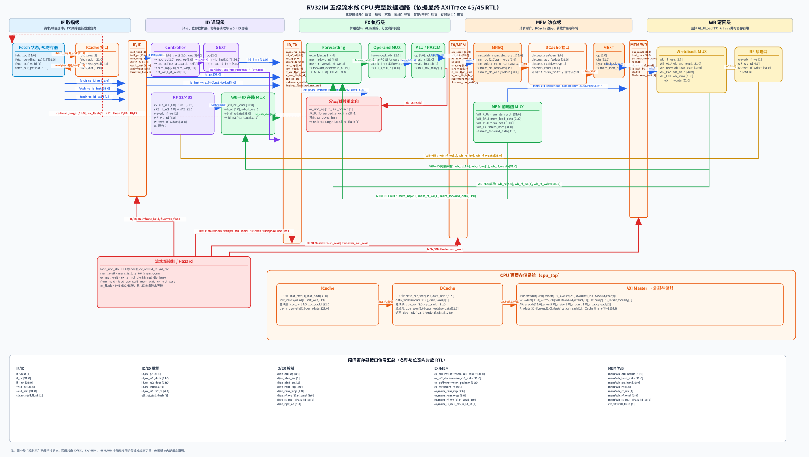
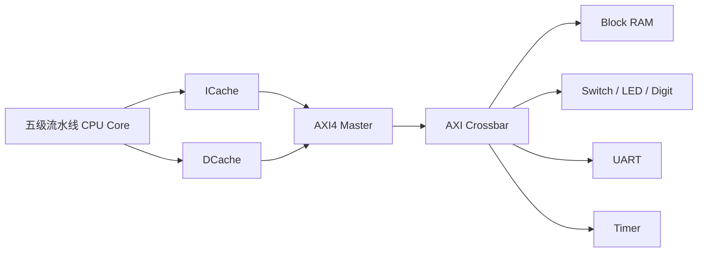

# PipelineCPU

一个基于 Verilog 的五级流水线 miniRV / RV32IM CPU 与 SoC 实现。项目包含流水线冒险处理、多周期乘除法、双 Cache、AXI4 Master，以及存储器映射外设接口。

## 功能概览

- 五级流水线：IF、ID、EX、MEM、WB
- 数据前递与 WB→ID 旁路
- Load-use 冒险检测、暂停和气泡插入
- 分支、JAL、JALR 重定向与流水线冲刷
- 多周期乘法、除法和余数运算
- 1 KB ICache 与 1 KB DCache
- AXI4 Master 读写状态机与独立通道反压处理
- 存储器映射 I/O：开关、LED、数码管、UART 和定时器

## 验证结果

代码已在课程提供的 Trace 差分测试框架中通过全部 45 项测试：

- Passed: 45
- Failed: 0

覆盖算术、逻辑、移位、比较、分支、跳转、访存以及 RV32M 乘除法指令。测试结果见 [验证记录](docs/verification.md)。

## 目录结构

```text
.
├── mySoC/                    # 可直接复制到 cdp-tests 的 RTL 源码
│   ├── miniRV_SoC.v          # SoC 顶层
│   ├── cpu_top.v             # CPU、Cache 与 AXI Master 集成
│   ├── cpu_core.v            # 五级流水线核心
│   ├── axi_master.v          # AXI4 Master
│   └── ...
├── docs/
│   ├── pipeline_datapath.svg
│   └── verification.md
└── README.md
```

## Trace 测试

1. 将 `mySoC` 目录复制到课程提供的 `cdp-tests` 根目录。
2. 在 WSL / Linux 中进入 `cdp-tests`。
3. 执行：

```bash
python3 run_all_tests.py
```

课程测试框架、测试用例和 Golden Model 不包含在本仓库中。

## Vivado 使用说明

将 `mySoC` 中全部 `.v`、`.vh` 文件加入 Vivado 工程的 `src/rtl`。仓库不包含 Vivado 自动生成的 IP 核和工程缓存；板级模式需要在 Vivado 中配置对应的时钟、AXI Crossbar、AXI GPIO、UART、Block Memory 以及约束文件。

## 设计图

### 五级流水线数据通路



### SoC 与 AXI 结构



